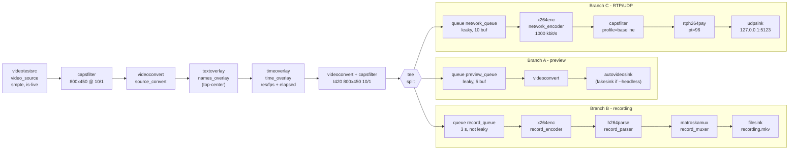
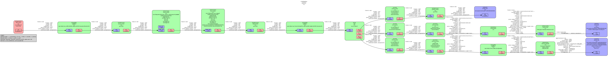

# Architecture

This document describes the pipelines of part 1 (shell / `gst-launch-1.0` version).
The native sender of part 3 will reuse the same pipeline.

Team configuration used below (from `config/team.conf`): `smpte`, 800x450, 10 fps,
UDP port 5123, overlay top-center, Matroska recording, H.264 over RTP, runtime 60 s.

## 1. Sender diagram

```
videotestsrc (video_source)  pattern=smpte is-live=true num-buffers=FPS*duration
      |  video/x-raw,width=800,height=450,framerate=10/1
videoconvert (source_convert)
      |
textoverlay (names_overlay)   "Nikola MILOSAVLJEVIC, Chenyi LI, Amirhossein POUYANFAR"  (top-center)
      |
timeoverlay (time_overlay)    "800x450 @ 10 fps | elapsed 0:00:03.013"                  (bottom-left)
      |
videoconvert ! video/x-raw,format=I420,width=800,height=450,framerate=10/1
      |
     tee (split)
      |
      +--------------------------+------------------------------------+
      |                          |                                    |
 A: PREVIEW                 B: RECORDING                         C: RTP/UDP
 queue (preview_queue)      queue (record_queue)                 queue (network_queue)
  leaky, 5 buffers           3 s, not leaky                       leaky, 10 buffers
      |                          |                                    |
 videoconvert               x264enc (record_encoder)             x264enc (network_encoder)
      |                      ultrafast, keyframe every 2 s        zerolatency, 1000 kbit/s,
 autovideosink                   |                                keyframe every 1 s
 (fakesink if --headless)   h264parse (record_parser)                 |  video/x-h264,profile=baseline
                                 |                               rtph264pay (network_payloader)
                            matroskamux (record_muxer)            pt=96, config-interval=1
                                 |                                    |
                            filesink (record_sink)               udpsink (network_sink)
                            artifacts/recording.mkv               127.0.0.1:5123
```

Same structure as a Mermaid diagram (rendered by GitHub):



### Pipeline graph from the real pipeline



`evidence/pipeline.png` is generated from the running sender, not drawn by hand:

```bash
./scripts/make-graph.sh
```

The script runs `scripts/sender.sh --headless --duration 4` with
`GST_DEBUG_DUMP_DOT_DIR` set, keeps the `*PAUSED_PLAYING.dot` file (at this point all
caps are negotiated, so the graph shows the real caps on every link) and converts it
with `dot -Tpng`. The raw `.dot` is kept next to it in `evidence/pipeline.dot`.

What we checked on the graph:
* `split` has three source pads `src_0`, `src_1`, `src_2`, each followed by its own queue;
* the link before the tee carries `video/x-raw, format=I420, width=800, height=450, framerate=10/1`;
* in the recording branch the H.264 caps are `stream-format=avc, alignment=au` already at
  the output of `record_encoder`: the caps negotiation propagated the `avc` requirement of
  `matroskamux` up to `x264enc`, so there is no `byte-stream` link in the graph (see
  section 5 for what the parser still does);
* after `network_payloader` the caps are `application/x-rtp, media=video, clock-rate=90000,
  encoding-name=H264, payload=96, packetization-mode=1` - these are the caps the receiver
  has to recreate by hand (section 7).

Receiver (`scripts/receiver.sh`):

```
udpsrc port=5123 caps="application/x-rtp,media=video,clock-rate=90000,encoding-name=H264,payload=96"
  ! rtpjitterbuffer latency=200
  ! rtph264depay ! h264parse ! avdec_h264
  ! videoconvert ! autovideosink                          (display mode)
  ! identity eos-after=N ! fakesink silent=false          (test mode)
```

## 2. Main elements

| Element | Name in pipeline | Purpose |
|---|---|---|
| `videotestsrc` | `video_source` | live test pattern (no camera needed). `is-live=true` makes it produce frames at the real frame rate. `num-buffers` stops it after the requested duration. |
| capsfilter | - | forces the assigned resolution and frame rate |
| `textoverlay` | `names_overlay` | team member names at the assigned position |
| `timeoverlay` | `time_overlay` | running time + configured resolution/fps |
| `tee` | `split` | duplicates every buffer into the 3 branches |
| `queue` | `*_queue` | one per branch, see section 6 |
| `autovideosink` / `fakesink` | `preview_sink` | local window / no display in headless mode |
| `x264enc` | `record_encoder`, `network_encoder` | raw video -> H.264 |
| `h264parse` | `record_parser` | H.264 parser (see below) |
| `matroskamux` / `mpegtsmux` | `record_muxer` | puts the H.264 stream in a container |
| `filesink` | `record_sink` | writes the file |
| `rtph264pay` / `rtpjpegpay` | `network_payloader` | cuts the encoded stream into RTP packets |
| `udpsink` | `network_sink` | sends the packets to 127.0.0.1:PORT |

## 3. Raw video caps before the tee

```
video/x-raw, format=I420, width=800, height=450, framerate=10/1
```

We fix `I420` before the tee so the format is known and the same for all branches
(without it, the format is whatever `videotestsrc`/overlays negotiate first). I420 is
accepted directly by `x264enc` and `jpegenc`, so the encoding branches do not need their
own conversion.

### Transmission and recording parameters

| | Network (branch C) | Recording (branch B) |
|---|---|---|
| Codec | H.264 (`x264enc`, `tune=zerolatency`, `speed-preset=ultrafast`, constrained-baseline, 1000 kbit/s, keyframe every 10 frames = 1 s) | H.264 (`x264enc`, `speed-preset=ultrafast`, keyframe every 20 frames = 2 s) |
| Packaging | RTP, `rtph264pay`, dynamic payload type **96**, clock-rate 90000, packetization-mode 1, SPS/PPS re-sent every 1 s | container **Matroska** (`matroskamux`), file `.mkv` |
| Destination | UDP `127.0.0.1`, port **5123** (`udpsink`) | `artifacts/recording.mkv` (or `--output`), `artifacts/test-recording.mkv` in `verify.sh` |

All these values come from `config/team.conf`; with `NETWORK_CODEC=jpeg` the network
branch becomes `jpegenc ! rtpjpegpay` (static payload type 26), with `CONTAINER=mpegts`
the recording uses `mpegtsmux` and `.ts`.

Why two separate encoders instead of one encoder before the tee: the two uses have
different needs (network: low latency, constant bitrate, short GOP for fast recovery;
recording: quality per byte, longer GOP). The cost is encoding twice; at 800x450 / 10 fps
with `ultrafast` this is cheap.

## 4. Raw video vs compressed video

* **Raw** (`video/x-raw`): from `videotestsrc` to the tee, the whole preview branch,
  and the input of the two encoders. On the receiver: after `avdec_h264`.
* **Compressed** (`video/x-h264` or `image/jpeg`): after `x264enc`/`jpegenc` in branches B and C,
  inside the `.mkv`/`.ts` file, and inside the RTP packets (`application/x-rtp`).
  On the receiver: from `udpsrc` to the input of the decoder.

An 800x450 I420 frame is 540 KB, so 5.4 MB/s at 10 fps; the H.264 network stream is
about 1 Mbit/s. That is why we only send compressed video on the network.

## 5. Encoder, payloader, depayloader, caps, parser, muxer

**Encoder vs RTP payloader.** The encoder (`x264enc`) compresses the pictures: it turns
raw frames into an H.264 bitstream (NAL units). The payloader (`rtph264pay`) does not
compress anything; it splits this bitstream into packets small enough for UDP
(MTU ~1400 bytes, fragmentation FU-A for big NAL units) and adds the RTP header
(payload type 96, sequence number, 90 kHz timestamp, marker bit at the end of a frame).
`config-interval=1` re-sends SPS/PPS every second so a receiver started late can decode.

**Why the receiver needs a depayloader.** The decoder expects a H.264 stream, not RTP
packets. `rtph264depay` removes the RTP headers, puts the fragments back together into
complete NAL units / access units, and uses the RTP timestamps for the buffer
timestamps. Before it, `rtpjitterbuffer` re-orders packets and removes network jitter.

**Why the receiver needs explicit caps.** UDP carries only bytes: `udpsrc` cannot know
that the datagrams contain RTP, which codec, which clock rate or payload type. Without
`caps="application/x-rtp,...,encoding-name=H264,payload=96"` the depayloader can not
negotiate and the pipeline fails with a `not-negotiated` error. (With RTSP/SDP this
information would come from the signalling, here there is none.)

**Parser (`h264parse`).** A parser reads the H.264 bitstream and describes it in the
caps (profile, level, resolution, `parsed=true`), checks that buffers are complete
access units and flags keyframes. In the recording branch, the pipeline graph shows that
`x264enc` already outputs `avc` because `matroskamux` asked for it, so here the parser
does not convert anything; it is kept because it guarantees the muxer gets parsed,
correctly flagged access units whatever the encoder (e.g. if we switch to `openh264enc`
or a hardware encoder that only outputs `byte-stream`, `h264parse` does the
byte-stream -> avc conversion and builds the `codec_data`). On the receiver and
playback side, `h264parse` sits between the depayloader/demuxer and `avdec_h264` so the
decoder gets complete access units with full caps.

**Recording muxer (`matroskamux`).** The muxer stores the H.264 stream with its
timestamps in a container: it writes the header (codec, resolution), the clusters of
frames with timestamps and, at EOS, the duration and the seek index. Without a
container a raw `.h264` file has no timing and many players cannot seek in it.
With `CONTAINER=mpegts` the scripts use `mpegtsmux` (`.ts`), which is more robust to a
truncated file but has no global index.

## 6. Queues

`tee` pushes the same buffer into its source pads one after the other **in the
same thread**. Without queues, a slow branch (e.g. the window waiting for vsync,
or x264 encoding a keyframe) would block the tee and so every other branch.
A `queue` after each tee pad starts a new streaming thread, so each branch runs
independently. With a live source a missing queue can also make the pipeline
stuck in PAUSED (the preroll of one sink waits for data that the other branch blocks).

* `preview_queue` - `leaky=downstream`, 5 buffers: if the display is late we
  drop old frames instead of slowing down the recording and the network. For a
  monitoring preview showing the latest frame is more important than showing all.
* `record_queue` - not leaky, up to 3 s: the recording must not lose frames,
  the 3 s buffer absorbs x264 peaks (keyframes).
* `network_queue` - `leaky=downstream`, 10 buffers: for live transmission a late
  frame is useless, better to drop it than to accumulate latency.

## 7. How the receiver reconstructs the stream

1. `udpsrc` receives the datagrams on port 5123 and tags them with the RTP caps.
2. `rtpjitterbuffer` orders them using the sequence numbers and waits up to 200 ms
   for late packets.
3. `rtph264depay` reassembles the FU-A fragments into NAL units / access units.
4. `h264parse` + `avdec_h264` decode to `video/x-raw` (I420, 800x450, 10/1).
5. The raw frames go to a window (display mode) or to `fakesink` (test mode).

## 8. Finalizing the recording

A Matroska file is only complete when `matroskamux` receives **EOS**: it then
rewrites the duration in the header and writes the cues (seek index).

* With `--duration N` (used by `verify.sh`), `videotestsrc` has `num-buffers=N*FPS`.
  After the last frame it sends EOS itself. The EOS goes through the tee into the
  three branches, `matroskamux` finalizes the file, `filesink` closes it, and when all
  sinks got EOS the pipeline posts EOS on the bus, `gst-launch-1.0` prints
  `Got EOS from element "pipeline0"` and exits with 0. No kill at all.
* Without a duration (`--duration 0`), the sender runs until Ctrl+C. Because we use
  `gst-launch-1.0 -e`, the interrupt is turned into an EOS event first, so the file
  is finalized the same way.
* We never use `kill -9`: the muxer would not get EOS and the file would have no
  duration/index.

## 9. Normal mode vs test mode

| | normal (display) mode | test (headless) mode |
|---|---|---|
| sender preview | `autovideosink` window | `fakesink sync=true` |
| sender recording / network | same | same |
| receiver | `videoconvert ! autovideosink` | `identity eos-after=N ! fakesink silent=false` |
| receiver end | Ctrl+C | stops by itself after N decoded frames (exit 0), or `timeout` -> exit 1 |
| proof of reception | look at the window | exit code + one `chain` line per decoded frame in `receiver.log` |

In test mode only the sinks change, the encode/payload/depayload/decode path is
exactly the same as in normal mode, so the test really checks the network chain.
